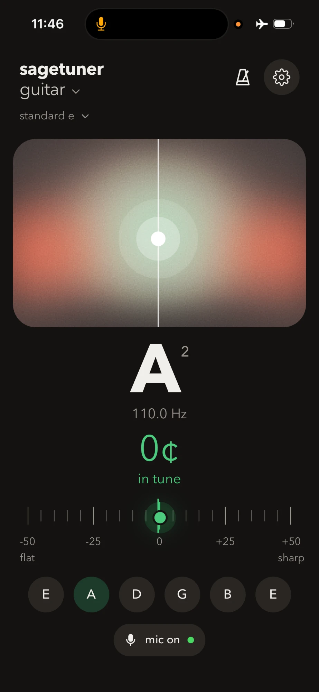
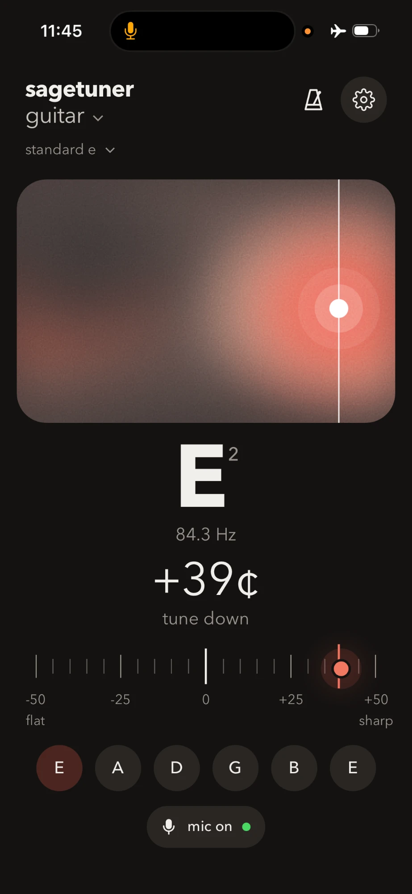

# sagetuner

A free guitar, bass and ukulele tuner plus metronome, built as a **PWA (progressive web app)**:
it runs in the browser, installs to your home screen like an app, and works offline.
No download, no account.

**Try it: [sagetuner.vercel.app](https://sagetuner.vercel.app)**

<p align="center">
  
  &nbsp;&nbsp;
  
</p>

## Features

- **Tuner** for guitar, bass and ukulele (several tunings each) plus chromatic mode
- A soft gradient that shows the reading: it leans left when flat, right when sharp,
  and settles into sage green when you're in tune; a −50…+50 cent scale moves with it
- Tap a string to hear its reference tone
- **Metronome** with accented first beat, 2–6 beats per bar, tap tempo and 30–250 BPM
- Adjustable reference pitch (A4), in-tune tolerance, light/dark mode
- Keeps the screen awake while you use it
- Installable on iPhone, Android and desktop, with install steps for each browser

## Privacy

The microphone is analysed live on your device. Audio is never recorded, stored or
sent anywhere. Visitor counts use Vercel Web Analytics, which is anonymous and
cookie-free.

## How it works

Plain HTML, CSS and JavaScript: no framework and no build step.

- `app.js`: pitch detection, the gradient and scale, metronome, settings and install flow
- `styles.css`: layout and light/dark themes
- `sw.js`: service worker that keeps the app working offline
- `manifest.webmanifest` and `icons/`: what makes it installable

Pitch detection uses the McLeod Pitch Method (normalised square difference function),
described in *A Smarter Way to Find Pitch* by Philip McLeod and Geoff Wyvill (2005).
The volume gate adapts to the room's background noise so quiet strings still register.

The metronome schedules clicks slightly ahead on the Web Audio clock, so timing stays
steady even when the page is busy.

## Run it locally

Any static file server works, for example:

```bash
npx http-server . -p 8765 -c-1
```

Then open http://localhost:8765. The microphone needs `localhost` or HTTPS.

## Credits

- Settings icon adapted from [Feather Icons](https://feathericons.com) (MIT, © Cole Bemis)
- McLeod Pitch Method: P. McLeod and G. Wyvill, 2005

## License

MIT. See [LICENSE](LICENSE).
